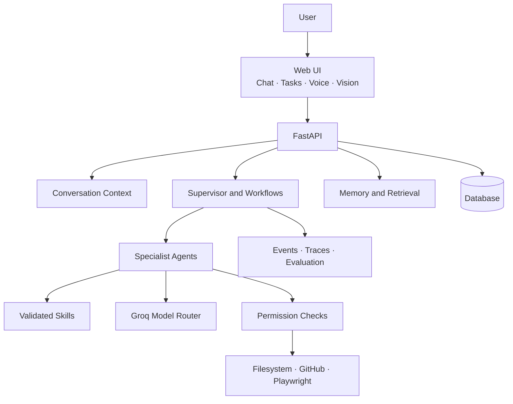

# EIVA Milestone Dashboard

> **A modular, Groq-powered personal assistant built one verified milestone at a time.**

| Project status | Next milestone | Model provider | Integrations in scope |
|---|---|---|---|
| ✅ M00–M15 complete | **All planned milestones complete** | Groq only | Filesystem · GitHub · Playwright |

CST and antenna-project integrations are out of scope.

**M00–M07 evaluation:** ✅ Deterministic local async integration checks passed, including agent timeout/cancellation, MCP permissions, workflow handoffs, and task SSE. [Read the evaluation report](docs/evaluations/M00-M07-runtime-review.md). Live Groq and real MCP server configuration remain operational setup items.

## System at a glance



## Build sequence


## Milestones and file-change records

Each checkpoint records the exact files changed for that milestone. File lists are updated as implementation happens, not guessed in advance.

| # | Milestone | Status | Checkpoint |
|---|---|---|---|
| 00 | Foundation and model screening | ✅ Complete | [M00](docs/checkpoints/M00-foundation-and-model-screening.md) |
| 01 | API contracts and chat foundation | ✅ Complete | [M01](docs/checkpoints/M01-api-contracts-and-chat-foundation.md) |
| 02 | Model service and model evaluation | ✅ Complete | [M02](docs/checkpoints/M02-model-service-and-model-evaluation.md) |
| 03 | Context and conversation management | ✅ Complete | [M03](docs/checkpoints/M03-context-and-conversation-management.md) |
| 04 | Agent base and registry | ✅ Complete | [M04](docs/checkpoints/M04-agent-base-and-registry.md) |
| 05 | Skill system and initial agents | ✅ Complete | [M05](docs/checkpoints/M05-skill-system-and-initial-agents.md) |
| 06 | Permissions and tool integrations | ✅ Complete | [M06](docs/checkpoints/M06-permissions-and-tool-integrations.md) |
| 07 | Task manager, event bus, and orchestration | ✅ Complete | [M07](docs/checkpoints/M07-task-manager-event-bus-and-orchestration.md) |
| 08 | Persistent storage and memory | ✅ Complete | [M08](docs/checkpoints/M08-persistent-storage-and-memory.md) |
| 09 | Document and code RAG | ✅ Complete | [M09](docs/checkpoints/M09-document-and-code-rag.md) |
| 10 | Voice interface | ✅ Complete | [M10](docs/checkpoints/M10-voice-interface.md) |
| 11 | Vision and desktop/browser control | ✅ Complete | [M11](docs/checkpoints/M11-vision-and-desktop-browser-control.md) |
| 12 | Frontend application | ✅ Complete | [M12](docs/checkpoints/M12-frontend-application.md) |
| 13 | External agent communication | ✅ Complete | [M13](docs/checkpoints/M13-external-agent-communication.md) |
| 14 | Observability, evaluation, and security hardening | ✅ Complete | [M14](docs/checkpoints/M14-observability-evaluation-and-security-hardening.md) |
| 15 | Packaging, setup, and release readiness | ✅ Complete | [M15](docs/checkpoints/M15-packaging-setup-and-release-readiness.md) |

### Work rhythm

1. Complete one milestone.
2. Record implementation files and evaluation results in its checkpoint.
3. Mark its checkbox only after its completion checks pass.
4. Report the changes and evaluation to the user.
5. Wait for the user's instruction before starting the next milestone.

## Current model-screening result

On the versioned five-case screen, both `openai/gpt-oss-120b` and `openai/gpt-oss-20b` passed all 13 criteria. Mean latency was 854 ms for 120B and 832 ms for 20B; total usage was 1,469 and 1,651 tokens, respectively. The result is a small initial screen, so role assignments remain provisional. See `data/model_evaluation.json`.

## Local setup

Python for this workspace: `D:\Suriya\tools\python\python.exe`. The project environment is `.venv`.

```powershell
& 'D:\Suriya\tools\python\python.exe' -m venv .venv
& '.\.venv\Scripts\python.exe' -m pip install -r requirements.txt
```

Set `GROQ_API_KEY` in `.env` before using model features. Keep `.env` private.

SQLite data is stored in the gitignored `data/eiva.sqlite3` file. Application startup applies pending migrations; run `python -m scripts.migrate_db` to apply or inspect them manually.
The default RAG corpus root is `data/knowledge`; configure additional confined roots with `RAG_ALLOWED_ROOTS` in `.env`.

```powershell
& '.\.venv\Scripts\python.exe' -m uvicorn backend.main:app --reload
& '.\.venv\Scripts\python.exe' -m scripts.evaluate_models
```

Full scope: [implementation roadmap](docs/IMPLEMENTATION_PLAN.md).
